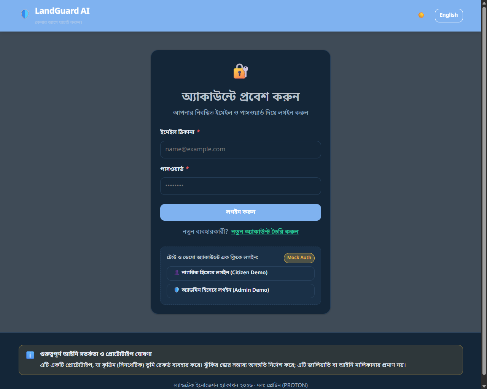
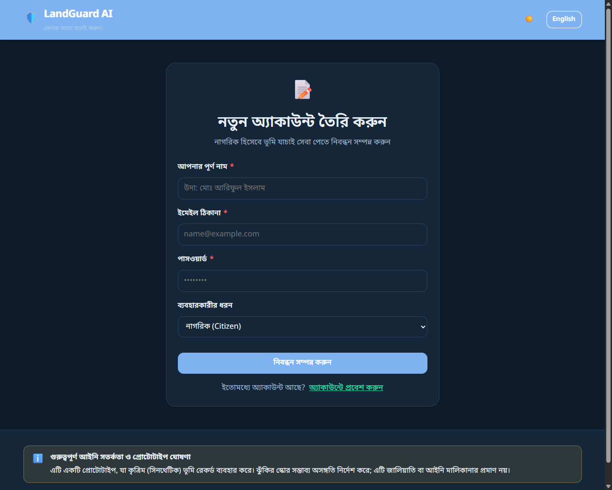
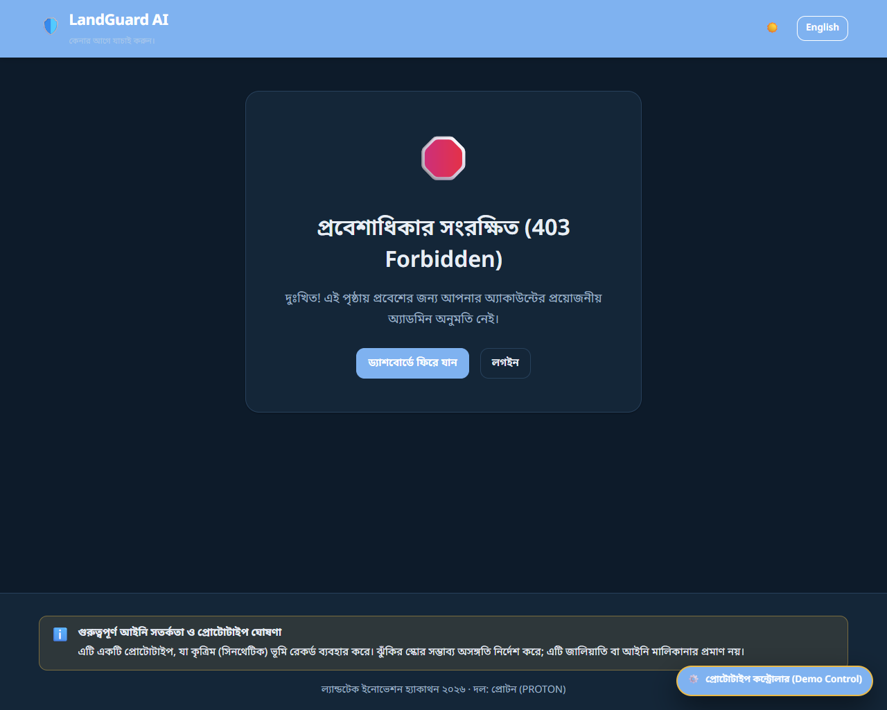
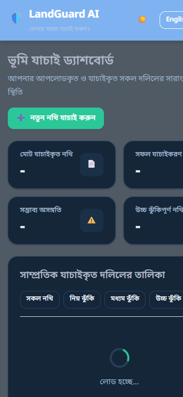
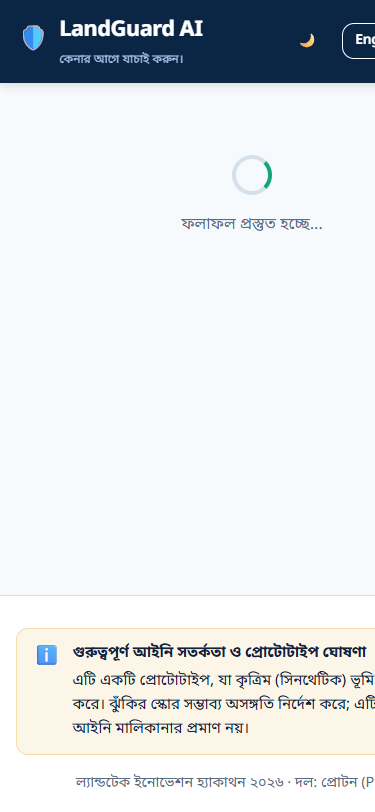
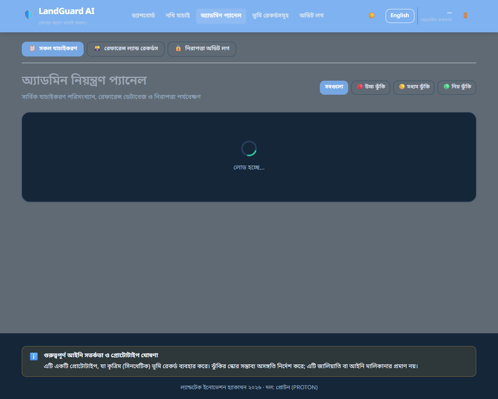
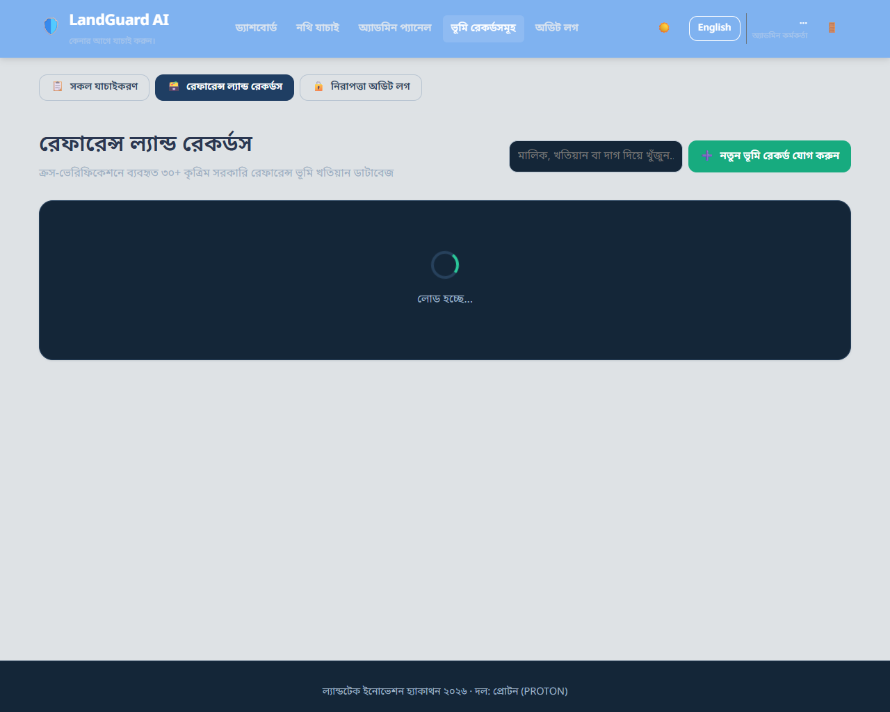
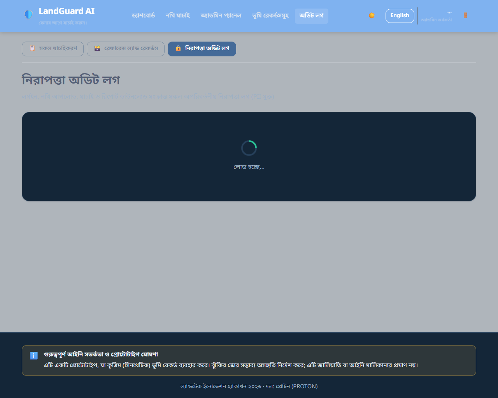
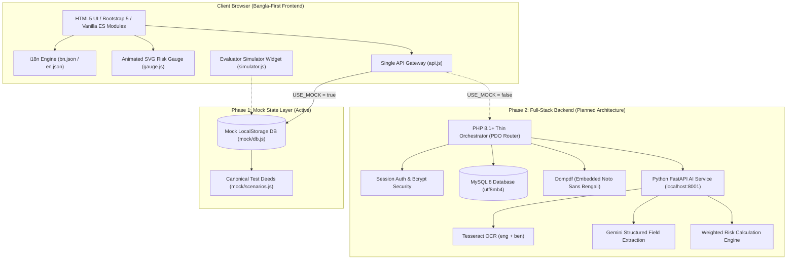
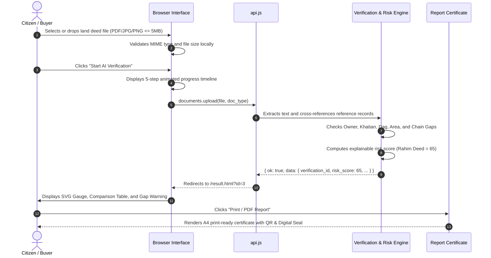

<div align="center">

# 🛡️ LandGuard AI
### Bangla-First AI-Assisted Land Document Verification & Fraud-Risk Detection Prototype
**Event:** LandTech Innovation Hackathon 2026 · **Team:** PROTON  
**Official Tagline:** *Verify Before You Buy.* (*কেনার আগে যাচাই করুন।*)

[](https://mohammademon10.github.io/LandGuard-AI-LandTech-Innovation-Hackathon/)
[](https://github.com/mohammademon10/LandGuard-AI-LandTech-Innovation-Hackathon/releases/tag/frontend-freeze)
[](LICENSE)
[](https://www.w3.org/WAI/standards-guidelines/wcag/)
[-13A579?style=for-the-badge)](scripts/check-i18n-parity.py)

---

[🌐 Live Demo](https://mohammademon10.github.io/LandGuard-AI-LandTech-Innovation-Hackathon/) • [📖 API Contract](docs/frontend-api-contract.md) • [📸 Visual Gallery](#-complete-page-by-page-visual-showcase) • [⚙️ Quickstart](#-installation--local-setup) • [🧪 Test Scenarios](#-canonical-test-scenarios)

</div>

---

> ### ⚠️ Mandatory Legal Notice & Synthetic Data Disclaimer
> **Bengali (বাংলা):** *"এটি একটি প্রোটোটাইপ, যা কৃত্রিম (সিনথেটিক) ভূমি রেকর্ড ব্যবহার করে। ঝুঁকির স্কোর সম্ভাব্য অসঙ্গতি নির্দেশ করে; এটি জালিয়াতি বা আইনি মালিকানার প্রমাণ নয়।"*  
> **English:** *"Prototype using synthetic land records. Risk score indicates potential inconsistencies, not proof of fraud or legal ownership."*  
> 
> *Our prototype demonstrates an AI-assisted verification workflow using structured and synthetic land records, designed to integrate with authorized digital land databases in the future. It does not replace official government registry records or legal title determination.*

---

## 📑 Table of Contents

1. [Executive Summary & Problem Statement](#-executive-summary--problem-statement)
2. [Complete Page-by-Page Visual Showcase](#-complete-page-by-page-visual-showcase)
3. [Core Capabilities & Features](#-core-capabilities--features)
4. [Canonical Verification Test Scenarios](#-canonical-verification-test-scenarios)
5. [System Architecture & Workflow Diagrams](#-system-architecture--workflow-diagrams)
6. [Verified Technology Stack](#-verified-technology-stack)
7. [Repository File & Directory Structure](#-repository-file--directory-structure)
8. [Installation & Local Setup](#-installation--local-setup)
9. [Pre-Seeded Demo Accounts & Credentials](#-pre-seeded-demo-accounts--credentials)
10. [Unified API Contract Specification](#-unified-api-contract-specification)
11. [Security, Privacy & Data Leak Prevention](#-security-privacy--data-leak-prevention)
12. [Automated QA Verification & Test Evidence](#-automated-qa-verification--test-evidence)
13. [Roadmap: Part A Frozen vs Part B Backend](#-roadmap-part-a-frozen-vs-part-b-backend)
14. [License & Team Credits](#-license--team-credits)

---

## 🌍 Executive Summary & Problem Statement

### The Real-World Land Crisis in Bangladesh
Land transactions in Bangladesh present severe financial and legal risks to citizens due to fragmented documentation, fraudulent deed creation, and historical chain gaps:
* **Identity Fraud & Impersonation:** Forged land deeds (*সাফ কবলা দলিল*) are frequently executed by impostors using fake names, mismatched patronymics, or fabricated inheritance certificates.
* **Area & Boundary Inflation:** Unscrupulous sellers deliberately inflate land areas on deeds beyond the actual recorded quota in the cadastral surveys, selling non-existent land.
* **Historical Chain-of-Title Gaps (Chain Gap):** Land changes hands through CS (*Cadastral Survey*), SA (*State Acquisition*), and RS (*Revisional Survey*) records. If any link—such as an unrecorded mutation (*নামজারি পরচা*) or inheritance partition—is missing, innocent buyers inherit protracted litigation.

### The LandGuard AI Solution
**LandGuard AI** provides an autonomous, explainable verification engine built specifically for Bangladesh land documentation:
1. **Bangla-First AI Extraction:** High-accuracy Optical Character Recognition (OCR) coupled with Gemini AI extracts structured fields (*Owner Name, Khatian No., Dag No., Mouza, Upazila, District, Area, Document No., and Registration Date*).
2. **Deterministic Cross-Verification:** Compares extracted parameters directly against digital reference cadastral land records with configurable fuzzy tolerance.
3. **Transparent & Explainable Risk Scoring:** Computes a normalized score from 0 to 100 based on fixed mathematical weights, pairing the score with actionable explanations for every penalty point.
4. **Print-Ready Verification Certificate:** Generates a secure, print-ready A4 verification certificate complete with dynamic QR verification, digital verification seals, and mandatory disclaimers.

---

## 📸 Complete Page-by-Page Visual Showcase

Every page across the LandGuard AI prototype has been built, tested, and captured in high resolution.

### 1. Landing Page (`frontend/index.html`)
The public-facing, Bangla-first landing page features an interactive hero section, a problem analysis breakdown, a 4-step workflow explainer, a fixed-weight risk calculator breakdown, interactive scenario preview tabs, and an FAQ accordion.

| Desktop View (1280px) | Mobile View (375px) |
|---|---|
|  |  |

---

### 2. User Authentication & Access Control

#### A. Sign In Page (`frontend/login.html`)
Features inline validation, error banners, keyboard accessibility, and **1-Click Demo Login** shortcuts for instant role-based exploration.


#### B. User Registration Page (`frontend/register.html`)
Allows new citizens or land officers to register with instant validation and role selection.


#### C. Role Barrier — 403 Forbidden Access Screen (`frontend/403.html`)
When a regular citizen attempts to access protected officer routes (e.g. `/admin/*`), the client-side route guard safely blocks access and displays this 403 screen.


---

### 3. Citizen Verification Dashboard (`frontend/dashboard.html`)
Provides real-time KPI overview cards (*Total Documents, Successfully Verified, Potential Conflicts, High Risk*), filterable verification tables (`ALL`, `LOW`, `MEDIUM`, `HIGH`), empty states, and loading indicators.

| Desktop View (1280px) | Mobile View (375px) |
|---|---|
|  |  |

---

### 4. Document Upload & Multi-Step Verification Flow (`frontend/upload.html`)
Features drag-and-drop file ingestion, file size ($\le 5$ MB) and format (PDF/JPG/PNG) validation, 1-click canonical deed presets, and a 5-step animated progress timeline (`aria-live="polite"`).


---

### 5. Detailed Verification Result & Risk Analysis (`frontend/result.html`)
Displays the animated SVG semicircle risk gauge, explainable risk reasons breakdown with point weights, field-by-field cross-verification table, prominent chain gap alert banner, and sequential ownership timeline.

| Desktop View (1280px) | Mobile View (375px) |
|---|---|
|  |  |

---

### 6. Print-Ready Verification Certificate (`frontend/report.html`)
Formatted for standard A4 printing and PDF export via `@media print`. Includes verification code, QR verification placeholder, itemized field comparisons, timeline summary, digital verification seal, and official signatures.


---

### 7. Land Officer Admin Management Console

#### A. System-Wide Verifications Monitor (`frontend/admin/index.html`)
Allows administrative land officers to oversee all citizen submissions, filter by risk level, and review case details.


#### B. Reference Land Records Registry (`frontend/admin/records.html`)
Full CRUD interface managing 30+ synthetic reference land records with real-time search, modal creation, editing, and deletion.


#### C. Privacy-Preserving Security Audit Trail (`frontend/admin/audit.html`)
Immutable audit log recording authentication, upload, verification, and report download events without exposing PII or raw document content.


---

## ✨ Core Capabilities & Features

### 1. Bangla-First User Experience & Full Bilingual Support
* **Native Typography:** Built from the ground up in standard Bengali using Google Fonts *Noto Sans Bengali*, configured with a line-height of $\ge 1.75$ to preserve complex conjuncts (*যুক্তাক্ষর*) without clipping.
* **100% i18n Key Parity:** Fully internationalized via [`frontend/js/i18n.js`](frontend/js/i18n.js). The primary dictionary [`frontend/i18n/bn.json`](frontend/i18n/bn.json) contains **176 keys**, matching the secondary English dictionary [`frontend/i18n/en.json`](frontend/i18n/en.json) with zero missing keys.
* **Localized Numerals:** Automatically formats numbers into authentic Bengali digits (`০-৯`) when in Bengali mode.

### 2. Mathematical & Explainable Risk Scoring Engine
* **Fixed Weight Model:** Strictly adheres to `PRD.md §5`. The score is purely mathematical and fully explainable:
  * Owner Name Mismatch: **35 pts**
  * Land Area Discrepancy: **20 pts**
  * Dag Number Mismatch: **15 pts**
  * Khatian Number Mismatch: **15 pts**
  * Ownership Chain Gap: **10 pts**
  * Missing Information / Unclear Seal: **3 pts**
  * Suspicious OCR / Inconsistent Dates: **2 pts**
* **Score Tiers:** `0-29` Low Risk (🟢), `30-59` Medium Risk (🟡), `60-100` High Risk (🔴).

### 3. Strict GovTech Visual Design System (`design.md`)
* **Color Reservation Guardrail:** Red, amber, and green are reserved **exclusively** for risk indicators and alert states. Normal UI elements utilize Deep Navy (`#0B2545`) and Forest Green (`#13A579`).
* **Accessibility (WCAG 2.1 AA):** High-contrast ratios ($\ge 4.5:1$), keyboard skip links, visible 3px focus rings, and full `prefers-reduced-motion` compliance.

### 4. Single Gateway Architecture (`frontend/js/api.js`)
* Every data operation across the application flows through one unified module (`api.js`) equipped with a `USE_MOCK` switch. Swapping to the live PHP backend in Phase 2 requires zero changes to UI templates.

### 5. Floating Prototype Simulator Widget (`frontend/js/simulator.js`)
* Injected into every page for hackathon judges and evaluators. Allows instant scenario switching, citizen/admin role swapping, network latency tuning (50ms–1500ms), simulated server failure testing, and one-click database resets.

---

## 🧪 Canonical Verification Test Scenarios

The prototype embeds the three canonical test deeds defined in `PRD.md §5` and `rules.md §1.7`:

```
┌─────────────────────────────────────────────────────────────────────────────┐
│                      CANONICAL SCENARIO SPECIFICATIONS                      │
├─────────────────────┬──────────────────┬─────────────┬──────────────────────┤
│ Scenario Slug       │ Document Type    │ Risk Score  │ Resulting Level      │
├─────────────────────┼──────────────────┼─────────────┼──────────────────────┤
│ Rahim_Land_Deed     │ Saf Kabala Deed  │ 65 / 100    │ 🔴 HIGH RISK (65)    │
│ medium_risk         │ Danpatra (Gift)  │ 40 / 100    │ 🟡 MEDIUM RISK (40)  │
│ clean_match         │ Sale Deed        │ 5 / 100     │ 🟢 LOW RISK (5)      │
└─────────────────────┴──────────────────┴─────────────┴──────────────────────┘
```

### 🔴 1. Canonical Hackathon Demo: Md. Rahim Land Deed (`Rahim_Land_Deed`)
* **Extracted Document Fields:** Md. Rahim, Khatian: 10245, Dag: 456, Area: 12.0 Decimal, Mouza: Mirzapur, Kaliakair, Gazipur.
* **Official Reference Record:** Md. Karim, Khatian: 10245, Dag: 456, Area: 10.0 Decimal, Mouza: Mirzapur, Kaliakair, Gazipur.
* **Point Breakdown:**
  * Owner Name Mismatch (`Md. Rahim` vs `Md. Karim`): **+35 points**
  * Land Area Discrepancy (12.0 vs 10.0 Decimal, 20% diff): **+20 points**
  * Ownership Chain Gap (2015 inheritance transfer deed missing): **+10 points**
  * **Total Score:** $35 + 20 + 10 = \mathbf{65}$ **(HIGH RISK 🔴)**

### 🟡 2. Partial Inconsistency Deed: Mst. Sultana Jahan (`medium_risk`)
* **Extracted Document Fields:** Mst. Sultana Jahan, Khatian: 6504, Dag: 889, Area: 8.35 Decimal, Savar, Dhaka.
* **Official Reference Record:** Sultana Jahan, Khatian: 6504, Dag: 889, Area: 8.0 Decimal, Savar, Dhaka.
* **Score:** **40 / 100 (MEDIUM RISK 🟡)** (Owner partial mismatch: 18 pts + Area partial mismatch: 10 pts + Chain gap: 10 pts + Low OCR clarity: 2 pts).

### 🟢 3. Clean Match Deed: Anwarul Islam (`clean_match`)
* **Extracted Document Fields:** Anwarul Islam, Khatian: 8412, Dag: 102, Area: 15.0 Decimal, Tejgaon, Dhaka.
* **Score:** **5 / 100 (LOW RISK 🟢)**. All fields match the reference record perfectly, and the historical transfer chain is uninterrupted.

---

## 🏗️ System Architecture & Workflow Diagrams

### 1. Overall System Architecture



### 2. End-to-End Verification Sequence



---

## 💻 Technology Stack

| Layer | Technology | Verified Version | Purpose |
|---|---|:---:|---|
| **Frontend Runtime** | Vanilla JavaScript | ES2022 Modules | Ultra-fast native execution without framework overhead |
| **Grid & Utilities** | Bootstrap 5 | 5.3.3 (Local) | Responsive 12-column layout and form styling |
| **Design System** | Pure CSS3 Variables | CSS3 Standard | Custom govtech design tokens and dark mode styling |
| **Typography** | Google Fonts | Web Font API | *Noto Sans Bengali*, *Inter*, *Poppins*, and *JetBrains Mono* |
| **Localization** | In-House i18n Engine | Custom (`i18n.js`) | Dynamic DOM translation, language switching, and Bengali digits |
| **Visual Graphics** | Native SVG Elements | SVG 1.1 / DOM | Semicircle risk gauge and digital verification seal |
| **Tooling & Scripts** | Python | 3.13.5 | Local multi-threaded development server and automated QA suites |
| **Node Environment** | Node.js | v24.15.0 | Deployment tooling and CI/CD workflow compatibility |
| **Version Control** | Git & GitHub | 2.47+ | Conventional commits and release tagging (`frontend-freeze`) |
| **CI/CD Pipeline** | GitHub Actions | `deploy-pages@v4` | Automated deployment of `frontend/` to GitHub Pages on push |

---

## 📁 Repository File & Directory Structure

```
LandGuard-AI-LandTech-Innovation-Hackathon/
├── .github/
│   └── workflows/
│       └── deploy.yml            # GitHub Pages automated deployment workflow
├── docs/
│   ├── frontend-api-contract.md  # Complete 14-endpoint frontend/backend API contract
│   └── screenshots/              # Verified screenshots across desktop, tablet, and mobile
├── frontend/
│   ├── index.html                # Public landing page with hero, explainer & FAQ
│   ├── login.html                # Authentication login page with 1-click demo buttons
│   ├── register.html             # Citizen and officer registration page
│   ├── dashboard.html            # Dashboard with KPI cards & filterable table
│   ├── upload.html               # Upload UI with presets & 5-step animated progress
│   ├── result.html               # Result page with SVG gauge, comparisons & timeline
│   ├── report.html               # A4 print-ready verification certificate with QR
│   ├── 403.html                  # Role barrier screen for unauthorized route attempts
│   ├── admin/
│   │   ├── index.html            # Admin monitor for all system verifications
│   │   ├── records.html          # Admin 30+ synthetic reference records CRUD
│   │   └── audit.html            # Privacy-preserving security audit log trail
│   ├── css/
│   │   ├── tokens.css            # Color, spacing, shadow, and font design tokens
│   │   ├── base.css              # Global reset, typography, and focus ring styles
│   │   ├── components.css        # Card, button, gauge, table, and timeline styles
│   │   └── bootstrap.min.css     # Localized Bootstrap 5 grid and utility CSS
│   ├── js/
│   │   ├── api.js                # Single unified API gateway with USE_MOCK switch
│   │   ├── auth.js               # Route guards, session management & 403 handlers
│   │   ├── i18n.js               # Localization engine and Bengali numerals formatter
│   │   ├── gauge.js              # Animated SVG semicircle risk gauge renderer
│   │   ├── shell.js              # Shared navigation, theme toggle & user pill
│   │   ├── simulator.js          # Evaluator prototype simulator drawer widget
│   │   └── mock/
│   │       ├── db.js             # LocalStorage client mock database engine
│   │       └── scenarios.js      # Canonical demo scenarios (Rahim = 65 / HIGH)
│   └── i18n/
│       ├── bn.json               # Primary Bengali dictionary (176 keys)
│       └── en.json               # Secondary English dictionary (176 keys)
├── scripts/
│   ├── run-frontend.cmd          # One-click Windows runner batch script
│   ├── serve-frontend.py         # Multi-threaded Python static development server
│   ├── check-i18n-parity.py      # Automated script verifying 100% i18n key parity
│   ├── test-frontend-qa.py       # Automated HTTP status, asset & disclaimer suite
│   ├── capture-all-screenshots.py# Headless Chrome responsive screenshot capture tool
│   └── make-paths-relative.py    # Path normalizer ensuring subpath deployment safety
├── index.html                    # Root redirector pointing to frontend/
├── architecture.md               # Technical architecture & database schema specification
├── design.md                     # GovTech design tokens & typography specification
├── memory.md                     # Living project memory & session task log
├── phases.md                     # Hackathon development phases & gate checklists
├── PRD.md                        # Project Requirements Document (Single Source of Truth)
├── rules.md                      # Binding guardrails and coding standards
└── LICENSE                       # Official MIT License
```

---

## 🚀 Installation & Local Setup

### Prerequisites
* Any modern web browser (Google Chrome, Microsoft Edge, Mozilla Firefox, or Safari).
* Python 3.8+ or Node.js (used solely to run the local static server).

### 1. Clone the Repository
```bash
git clone https://github.com/mohammademon10/LandGuard-AI-LandTech-Innovation-Hackathon.git
cd LandGuard-AI-LandTech-Innovation-Hackathon
```

### 2. Start the Frontend Server

#### Option A: One-Click Windows Runner (Recommended)
Double-click `scripts\run-frontend.cmd` or run:
```cmd
scripts\run-frontend.cmd
```

#### Option B: Python Static Server
```bash
python scripts/serve-frontend.py
```

#### Option C: Node.js / NPX
```bash
npx serve frontend -p 8080
```

### 3. Open in Browser
Visit the application in your browser:  
👉 **[http://127.0.0.1:8080](http://127.0.0.1:8080)**

---

## 🔑 Pre-Seeded Demo Accounts & Credentials

The prototype includes pre-configured mock roles. You can enter the credentials manually or click the **1-Click Demo Login** buttons on [`login.html`](frontend/login.html):

| User Role | Email Address | Password | Permissions & Available Routes |
|---|---|---|---|
| **Citizen (নাগরিক)** | `citizen@landguard.gov.bd` | `Password123!` | Dashboard, Upload, View Personal Results & Print Reports |
| **Land Officer (অ্যাডমিন)** | `admin@landguard.gov.bd` | `AdminPassword123!` | Full Admin Panel, Reference Records CRUD & Security Audit Trail |

---

## 📋 Unified API Contract Specification

All data queries pass through [`frontend/js/api.js`](frontend/js/api.js). The full contract is documented in [`docs/frontend-api-contract.md`](docs/frontend-api-contract.md):

```
┌────────┬─────────────────────────────┬──────────────┬──────────────────────────────────────────┐
│ Method │ Endpoint Route              │ Access Role  │ Purpose                                  │
├────────┼─────────────────────────────┼──────────────┼──────────────────────────────────────────┤
│ POST   │ /api/auth/login             │ Public       │ Authenticate user and issue session      │
│ POST   │ /api/auth/register          │ Public       │ Register new citizen or officer account  │
│ POST   │ /api/auth/logout            │ Auth         │ Terminate user session                   │
│ GET    │ /api/me                     │ Auth         │ Retrieve current user profile and locale │
│ PATCH  │ /api/me/language            │ Auth         │ Persist language preference (bn / en)    │
│ POST   │ /api/documents/upload       │ Auth         │ Ingest document and initiate verification│
│ GET    │ /api/documents              │ Auth         │ List user's verified land documents      │
│ GET    │ /api/verifications/{id}     │ Owner/Admin  │ Fetch complete comparison and score data │
│ GET    │ /api/verifications/{id}/rep │ Owner/Admin  │ Retrieve A4 printable certificate payload│
│ GET    │ /api/dashboard/stats        │ Auth         │ Retrieve 4 KPI counters and recent deeds │
│ GET    │ /api/ownership/{land_id}    │ Owner/Admin  │ Retrieve historical ownership chain      │
│ GET    │ /api/admin/verifications    │ Admin Only   │ Monitor system-wide verifications        │
│ CRUD   │ /api/admin/records          │ Admin Only   │ Create, Read, Update, Delete ref records │
│ GET    │ /api/admin/audit            │ Admin Only   │ Review immutable security audit trail    │
└────────┴─────────────────────────────┴──────────────┴──────────────────────────────────────────┘
```

**Standard Response Envelope:**
```json
// Success Response
{ "ok": true, "data": { ... }, "error": null }

// Failure Response
{ "ok": false, "data": null, "error": { "code": "STRING_CODE", "message_key": "i18n.key" } }
```

---

## 🔒 Security, Privacy & Data Leak Prevention

* **Synthetic Data Guardrail:** No real citizens, personal data, or real land parcels are used. All sample documents and reports carry the watermark `"SYNTHETIC / SAMPLE - NOT A REAL DOCUMENT"`.
* **Zero PII Exposure:** Passwords, authentication tokens, and raw document contents are never logged in the security audit trail or exposed via client-side state.
* **Role-Based Guards & 403 Barrier:** Administrative routes are guarded at the router level. Unauthorized attempts immediately redirect to [`403.html`](frontend/403.html).
* **Cross-User Isolation:** Regular citizens are strictly restricted to reading their own documents and verification IDs.

---

## 🧪 Automated QA Verification & Test Evidence

The repository includes automated test suites ensuring complete technical integrity:

### 1. Bilingual Key Parity Test (`scripts/check-i18n-parity.py`)
```bash
python scripts/check-i18n-parity.py
```
```text
Total Bangla keys: 176
Total English keys: 176
✅ 100% Key Parity Confirmed! bn.json and en.json match perfectly.
```

### 2. End-to-End Frontend QA Test Suite (`scripts/test-frontend-qa.py`)
```bash
python scripts/test-frontend-qa.py
```
```text
==================================================
 LandGuard AI - Automated Frontend QA Test Suite
 Target Base URL: http://127.0.0.1:8080
==================================================

--- [1] Checking HTML Pages ---
  [200 OK] /index.html            (37,282 bytes) [✓ Disclaimer]
  [200 OK] /login.html            (10,818 bytes) [✓ Disclaimer]
  [200 OK] /register.html         (10,709 bytes) [✓ Disclaimer]
  [200 OK] /dashboard.html        (16,772 bytes) [✓ Disclaimer]
  [200 OK] /upload.html           (22,707 bytes) [✓ Disclaimer]
  [200 OK] /result.html           (22,472 bytes) [✓ Disclaimer]
  [200 OK] /report.html           (19,117 bytes) [✓ Disclaimer]
  [200 OK] /admin/index.html      (12,729 bytes) [✓ Disclaimer]
  [200 OK] /admin/records.html    (15,797 bytes) [✓ Disclaimer]
  [200 OK] /admin/audit.html      ( 9,428 bytes) [✓ Disclaimer]
  [200 OK] /403.html              ( 4,508 bytes) [✓ Disclaimer]

--- [2] Checking CSS, JS & i18n Assets ---
  [200 OK] 15/15 Static Assets verified (Tokens, Base, Components, API, DB, Scenarios)

--- [3] Checking Canonical Demo Scenarios ---
  ✅ Rahim_Land_Deed risk_score is strictly 65 / HIGH (35 + 20 + 10)
  ✅ clean_match (LOW: 5) and medium_risk (MEDIUM: 40) confirmed.

--- [4] Checking Mandatory Disclaimer Strings ---
  ✅ Mandatory BN and EN disclaimer strings verified across all pages.

==================================================
🎉 ALL FRONTEND QA CHECKS PASSED SUCCESSFULLY!
==================================================
```

---

## 🗺️ Roadmap: Part A Frozen vs Part B Backend

```
  [COMPLETED & FROZEN] Part A: Frontend First (Git Tag: frontend-freeze)
  ├── F0: Scaffold & Unified API Gateway (api.js with USE_MOCK switch)
  ├── F1: GovTech Design Tokens, Base Typography & Component Library
  ├── F2: Bangla-First Authentication UI, Validation & 403 Barrier
  ├── F3: Dashboard with KPIs, Risk Badges, Filters & Empty States
  ├── F4: Document Upload UI, 5-Step Animated Progress & Demo Presets
  ├── F5: Explainable Result Page, SVG Risk Gauge & Chain Gap Indicator
  ├── F6: Print-Ready A4 Verification Certificate with QR & Digital Seal
  ├── F7: Admin Management Console (Records CRUD & Security Audit Trail)
  ├── F8: Comprehensive Landing Page with Fixed-Weight Scoring Explainer
  ├── F9: English Toggle Layer with 100% Key Parity Audit (176 Keys)
  └── F10: Automated QA Suite & GitHub Pages CI/CD Deployment

  [UPCOMING] Part B: Full-Stack Backend & AI Integration (Prompt 2)
  ├── B0: Backend Scaffold & Environment Setup (PHP 8.1+, Composer)
  ├── B1: MySQL 8 Schema Initialization & 30+ Synthetic Reference Seeds
  ├── B2: Real Authentication (bcrypt password_hash & HttpOnly Sessions)
  ├── B3: Python FastAPI AI Extraction Service (Tesseract OCR & Gemini API)
  ├── B4: Normalizer & Weighted Risk Calculation Engine (ai/risk_engine)
  ├── B5: Transactional Upload -> Extract -> Verify End-to-End Integration
  ├── B6: Dompdf PDF Generation with Embedded Noto Sans Bengali Font
  ├── B7: Admin APIs, Audit Logger & Historical Ownership Chain Adapter
  ├── B8: Security Hardening & 30-Run E2E Verification Suite
  └── B9: Final Hackathon Submission Pack, Pitch Script & Architecture Docs
```

---

## 👥 License & Credits

### Team PROTON
* **Event:** LandTech Innovation Hackathon 2026
* **Repository Maintainer:** MD. Emon Hossain ([@mohammademon10](https://github.com/mohammademon10))
* **License:** This project is open-source and released under the [MIT License](LICENSE).

---

<div align="center">
  <sub>Developed by Team PROTON · LandTech Innovation Hackathon 2026</sub><br>
  <strong>LandGuard AI — Verify Before You Buy.</strong>
</div>
