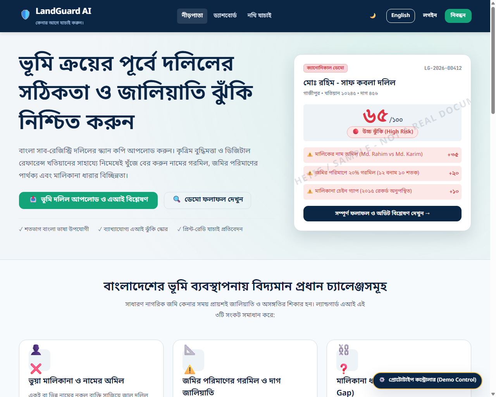
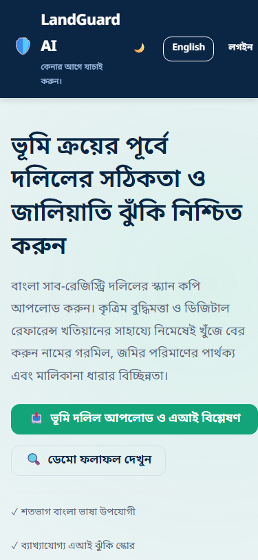
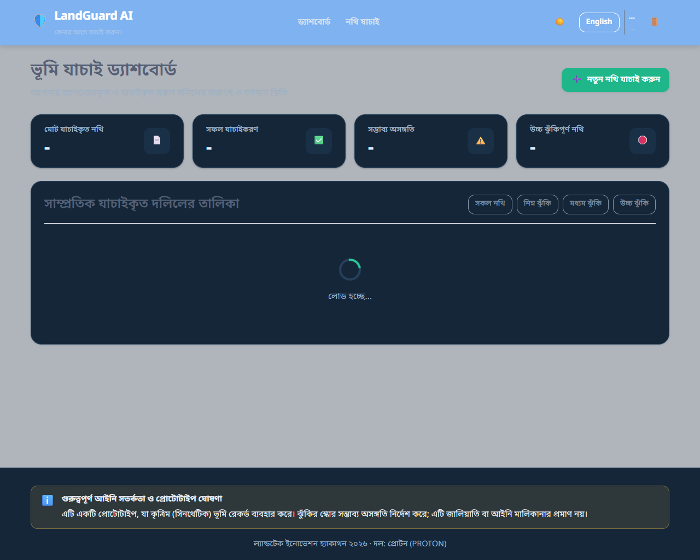
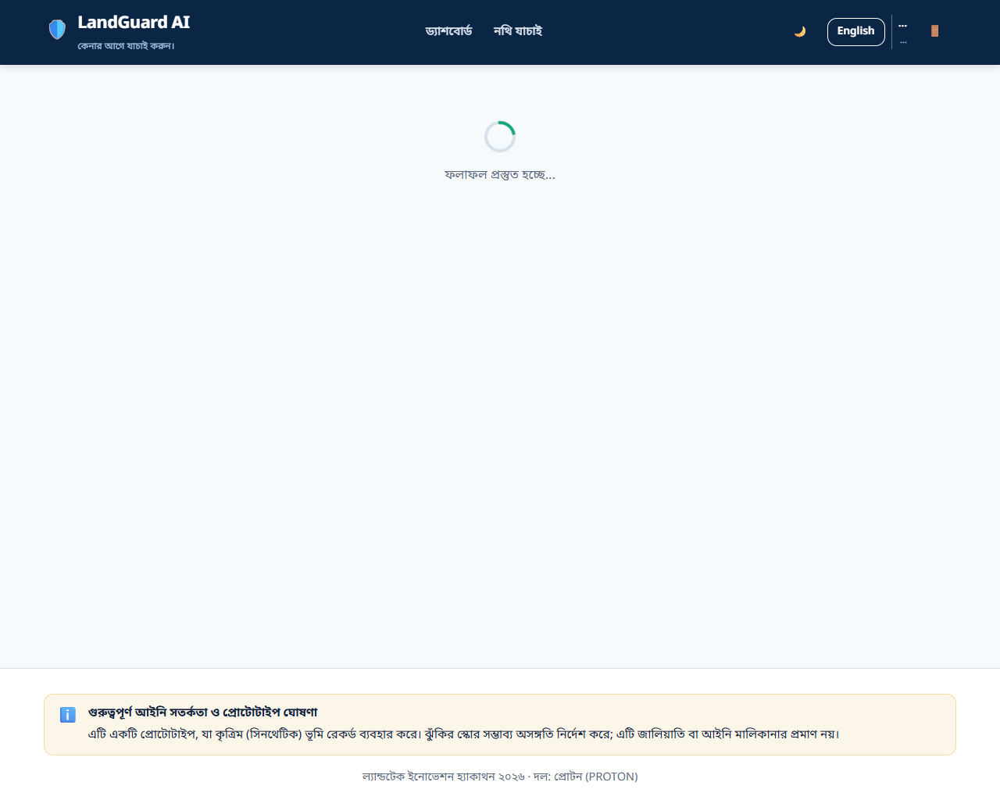
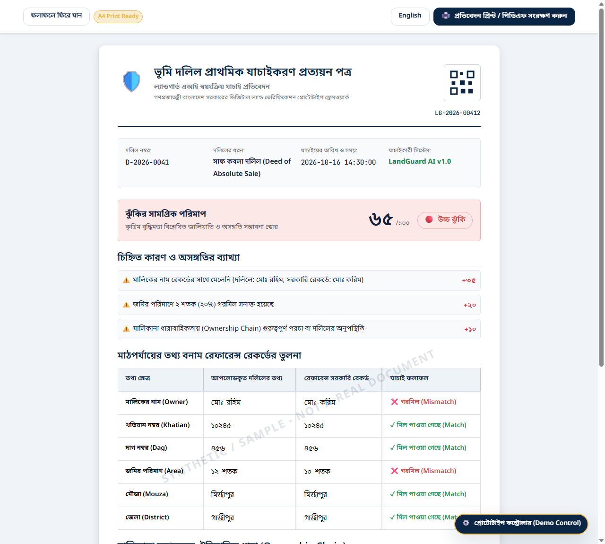
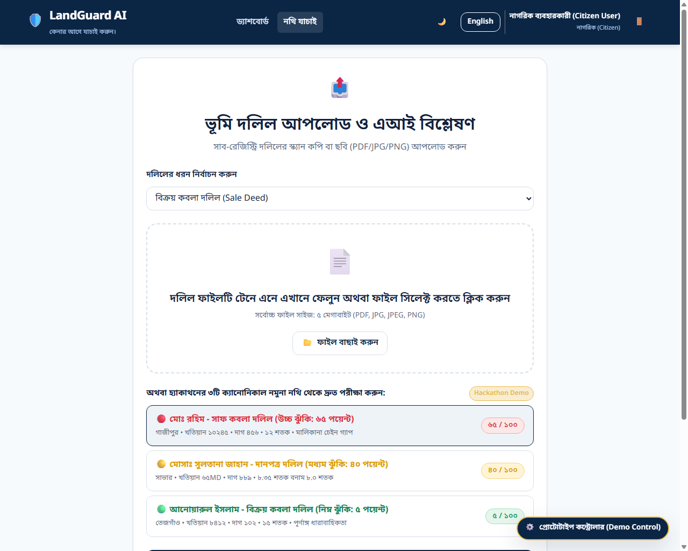
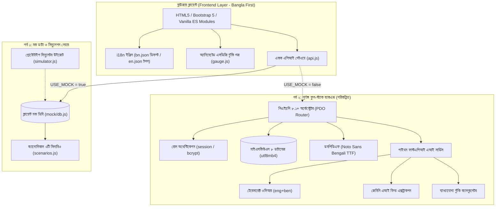
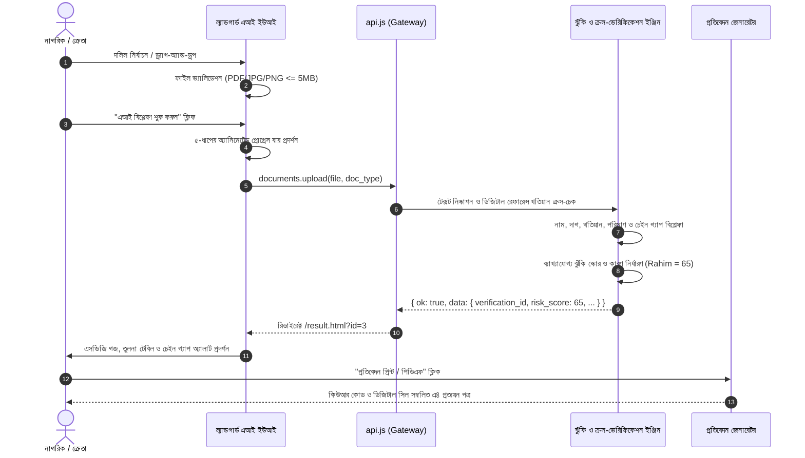

<div align="center">

# 🛡️ LandGuard AI (ল্যান্ডগার্ড এআই)
### বাংলা-প্রথম এআইনির্ভর ভূমি দলিল যাচাইকরণ ও জালিয়াতি ঝুঁকি সনাক্তকরণ প্ল্যাটফর্ম
**Bangla-First AI-Assisted Land Document Verification & Fraud-Risk Detection Prototype**

[](https://mohammademon10.github.io/LandGuard-AI-LandTech-Innovation-Hackathon/)
[](https://github.com/mohammademon10/LandGuard-AI-LandTech-Innovation-Hackathon/releases/tag/frontend-freeze)
[](LICENSE)
[](https://www.w3.org/WAI/standards-guidelines/wcag/)
[-13A579?style=for-the-badge)](scripts/check-i18n-parity.py)

**ল্যান্ডটেক ইনোভেশন হ্যাকাথন ২০২৬ (LandTech Innovation Hackathon 2026)**  
**দল (Team):** প্রোটন (PROTON) · **মূল স্লোগান (Tagline):** *কেনার আগে যাচাই করুন।* (Verify Before You Buy.)

---

[🌐 লাইভ ডেমো (Live Demo)](https://mohammademon10.github.io/LandGuard-AI-LandTech-Innovation-Hackathon/) • [📖 এপিআই চুক্তি (API Contract)](docs/frontend-api-contract.md) • [📸 স্ক্রিনশট গ্যালারি (Screenshots)](docs/screenshots/) • [⚙️ রান নির্দেশিকা (Run Guide)](#-installation--local-setup)

</div>

---

> ### ⚠️ আইনি সতর্কতা ও প্রোটোটাইপ ঘোষণা (Legal Disclaimer)
> **বাংলা:** "এটি একটি প্রোটোটাইপ, যা কৃত্রিম (সিনথেটিক) ভূমি রেকর্ড ব্যবহার করে। ঝুঁকির স্কোর সম্ভাব্য অসঙ্গতি নির্দেশ করে; এটি জালিয়াতি বা আইনি মালিকানার প্রমাণ নয়।"  
> **English:** "Prototype using synthetic land records. Risk score indicates potential inconsistencies, not proof of fraud or legal ownership."  
> *Our prototype demonstrates an AI-assisted verification workflow using structured and synthetic land records, designed to integrate with authorized digital land databases in the future.*

---

## 📑 সূচিপত্র (Table of Contents)

1. [প্রকল্প পরিচিতি ও পটভূমি (Project Overview & Problem Statement)](#-project-overview--problem-statement)
2. [মূল বৈশিষ্ট্যসমূহ (Core Features & Capabilities)](#-core-features--capabilities)
3. [ক্যানোনিকাল ৩টি টেস্ট দৃশ্যপট (Canonical Test Scenarios)](#-canonical-test-scenarios)
4. [ভিজ্যুয়াল শোকেস ও স্ক্রিনশট (Visual Showcase)](#-visual-showcase)
5. [সিস্টেম আর্কিটেকচার ও ডেটা প্রবাহ (Architecture & Workflows)](#-system-architecture--workflows)
6. [প্রযুক্তিগত স্ট্যাক (Technology Stack)](#-technology-stack)
7. [ফোল্ডার ও ফাইল কাঠামো (Project Structure)](#-project-structure)
8. [লোকাল সেটআপ ও রান করার নির্দেশিকা (Installation & Local Setup)](#-installation--local-setup)
9. [টেস্ট অ্যাকাউন্ট ও ১-ক্লিক ডেমো লগইন (Demo & Test Accounts)](#-demo--test-accounts)
10. [ইউনিফাইড এপিআই চুক্তি (Unified API Contract Summary)](#-unified-api-contract-summary)
11. [নিরাপত্তা, প্রাইভেসী ও ডেটা লিকেজ রোধ (Security & Privacy Controls)](#-security--privacy-controls)
12. [স্বয়ংক্রিয় কিউএ ও কোয়ালিটি গেট ফলাফল (Automated QA & Quality Gates)](#-automated-qa--quality-gates)
13. [ডেভেলপমেন্ট রোডম্যাপ (Development Roadmap)](#-development-roadmap)
14. [লাইসেন্স ও কৃতজ্ঞতা (License & Team Credits)](#-license--credits)

---

## 🌍 Project Overview & Problem Statement

### বিদ্যমান সংকট (The Problem in Bangladesh Land Transactions)
বাংলাদেশে জমি কেনাবেচা ও হস্তান্তর প্রক্রিয়ায় সাধারণ নাগরিকরা প্রতিনিয়ত নানাবিধ জালিয়াতি ও আইনি ঝুঁকির সম্মুখীন হন:
* **ভুয়া মালিকানা দাবি:** একই নামের একাধিক ব্যক্তি সাজিয়ে বা নকল ওয়ারিশ সনদ তৈরি করে সাব-রেজিস্ট্রি অফিসে ভুয়া সাফ কবলা দলিল সম্পাদন করা হয়।
* **জমির পরিমাণ ও দাগ নম্বরের গরমিল:** মূল মৌজা ও খতিয়ান রেকর্ডে যে পরিমাণ জমি বরাদ্দ রয়েছে, তার চেয়ে বেশি জমি দলিলে দেখিয়ে বিক্রয় করা হয়।
* **মালিকানা ধারার বিচ্ছিন্নতা (Ownership Chain Gap):** সিএস (CS), এসএ (SA) বা আরএস (RS) খতিয়ান থেকে বর্তমান বিক্রেতা পর্যন্ত কোনো একটি নামজারি বা উত্তরাধিকার দলিল অনুপস্থিত থাকলে ভবিষ্যতে ক্রেতা চরম আইনি জটিলতা ও মামলার শিকার হন।

### ল্যান্ডগার্ড এআই এর সমাধান (The Solution)
**LandGuard AI** হলো একটি আধুনিক, বাংলা-প্রথম কৃত্রিম বুদ্ধিমত্তানির্ভর প্রোটোটাইপ যা দলিল যাচাইকরণকে সম্পূর্ণ স্বয়ংক্রিয়, স্বচ্ছ এবং ব্যাখ্যাযোগ্য করে তোলে:
1. **বাংলা অপটিক্যাল ও এআই এক্সট্রাকশন:** দলিলের স্ক্যান কপি থেকে মালিকের নাম, খতিয়ান নম্বর, দাগ নম্বর, মৌজা, উপজেলা, জেলা, জমির পরিমাণ এবং নিবন্ধনের তারিখ স্বয়ংক্রিয়ভাবে সংগ্রহ করে।
2. **ক্রস-ভেরিফিকেশন ও অমিল সনাক্তকরণ:** সংগৃহীত তথ্য ডিজিটাল রেফারেন্স খতিয়ানের সাথে মিলিয়ে দেখে অক্ষরের বানান, সাংখ্যিক পরিমাণ এবং ভৌগোলিক তথ্যের গরমিল চিহ্নিত করে।
3. **ব্যাখ্যাযোগ্য ঝুঁকি পরিমাপ (Explainable Risk Scoring):** একটি স্বচ্ছ গাণিতিক ফর্মুলায় ১০০ স্কোরের মধ্যে ঝুঁকি নিরূপণ করে (০-২৯ নিম্ন 🟢, ৩০-৫৯ মধ্যম 🟡, ৬০-১০০ উচ্চ 🔴) এবং প্রতিটি পেনাল্টি পয়েন্টের সুনির্দিষ্ট কারণ ব্যাখ্যা করে।
4. **প্রিন্ট-রেডি প্রত্যয়ন পত্র:** তাত্ক্ষণিক অনলাইনে সত্যতা যাচাইয়ের জন্য কিউআর কোড ও ডিজিটাল সিল সম্বলিত এ৪ ফরম্যাটের প্রত্যয়ন পত্র প্রদান করে।

---

## ✨ Core Features & Capabilities

| ফিচার | বিবরণ | বাস্তবায়ন স্থিতি |
|---|---|:---:|
| **বাংলা-প্রথম ইউআই (Bangla-First UI)** | ডিফল্ট `<html lang="bn">`, *Noto Sans Bengali* ফন্ট, $\ge 1.75$ লাইন হাইট, খাঁটি বাংলা সংখ্যামালা (`০-৯`) | ✅ সম্পন্ন (Frozen) |
| **দ্বিভাষিক অনুবাদ (100% i18n)** | `bn.json` মূল সূত্র (১৭৬টি কী), সেকেন্ডারি ইংরেজি টগল `en.json` এ হুবহু ১৭৬টি কী সম্বলিত | ✅ সম্পন্ন (Frozen) |
| **ঝুঁকি কালার রিজার্ভেশন** | ডিজাইন সিস্টেম নিয়ম অনুসারে লাল, হলুদ ও সবুজ শুধুমাত্র ঝুঁকির স্থিতি নির্দেশনায় সংরক্ষিত | ✅ সম্পন্ন (Frozen) |
| **অ্যানিমেটেড এসভিজি ঝুঁকি গজ** | সেমি-সার্কেল এসভিজি স্টোক অ্যানিমেশন, সেন্টারে ঝুঁকি স্কোর, `prefers-reduced-motion` সম্মান করে | ✅ সম্পন্ন (Frozen) |
| **ফিল্ড তুলনা টেবিল** | তথ্য ক্ষেত্র, আপলোডকৃত তথ্য, রেফারেন্স সরকারি রেকর্ড ও রেজাল্ট স্ট্যাটাস ব্যাজ (✓ ⚠️ ❌) | ✅ সম্পন্ন (Frozen) |
| **মালিকানা ধারাবাহিকতা টাইমলাইন** | পূর্বতন মালিক থেকে বর্তমান মালিক পর্যন্ত হস্তান্তর ইতিহাস ও চেইন গ্যাপ অ্যালার্ট ব্যানার | ✅ সম্পন্ন (Frozen) |
| **প্রিন্ট-রেডি প্রত্যয়ন পত্র** | এ৪ প্রিন্ট ফ্রেন্ডলি `@media print`, কিউআর কোড, ডিজিটাল প্রত্যয়ন সিল ও সিগনেচার ব্লক | ✅ সম্পন্ন (Frozen) |
| **রোল-ভিত্তিক এক্সেস কন্ট্রোল** | `citizen` ও `admin` রোল বিভাজন, রাউট গার্ডস ও অননুমোদিত প্রবেশের জন্য নিবেদিত ৪০৩ পর্দা | ✅ সম্পন্ন (Frozen) |
| **অ্যাডমিন নিয়ন্ত্রণ কনসোল** | সার্বিক যাচাইকরণ মনিটরিং, ৩০+ রেফারেন্স ল্যান্ড রেকর্ডস সিআরইউডি (CRUD) ও অডিট লগ ট্রেইল | ✅ সম্পন্ন (Frozen) |
| **প্রোটোটাইপ সিমুলেটর উইজেট** | মূল্যায়নকারীদের জন্য ফ্লোটিং কন্ট্রোলার: ১-ক্লিকে দৃশ্যপট বদল, রোল টগল, লেটেন্সি ও ত্রুটি সিমুলেশন | ✅ সম্পন্ন (Frozen) |
| **একক এপিআই গেটওয়ে (`api.js`)** | `USE_MOCK = true` সুইচ; ব্যাকএন্ড ও ফ্রন্টএন্ডের মধ্যে কঠোর আর্কিটেকচারাল সেপারেশন | ✅ সম্পন্ন (Frozen) |
| **পাইথন ফাস্টএপিআই ও ওসিআর** | টেসারাক্ট বাংলা ওসিআর, জেমিনি এলএলএম এক্সট্রাকশন ও নরমালাইজার | ⏳ পর্ব ২ (Part B) |
| **পিএইচপি অর্কেস্ট্রেটর ও মাইএসকিউএল** | পিএইচপি ৮.১ পিডিও, মাইএসকিউএল ৮ ডাটাবেজ পারসিস্টেন্স ও ডমপিডিএফ | ⏳ পর্ব ২ (Part B) |

---

## 🧪 Canonical Test Scenarios

`PRD.md §5` এবং `rules.md §1.7` অনুযায়ী সিস্টেমে ৩টি ক্যানোনিকাল দৃশ্যপট নির্ধারিত রয়েছে:

```
┌─────────────────────────────────────────────────────────────────────────────┐
│                       FIXED RISK SCORING WEIGHTS                            │
├────────────────────────────────┬─────────┬──────────────────────────────────┤
│ Factor                         │ Weight  │ Scoring Rule                     │
├────────────────────────────────┼─────────┼──────────────────────────────────┤
│ Owner Name Mismatch            │ 35 pts  │ Exact/Fuzzy < 75 = 35; Partial = 18│
│ Land Area Discrepancy          │ 20 pts  │ > 5% diff = 20; 2-5% diff = 10   │
│ Dag Number Mismatch            │ 15 pts  │ Exact match after normalization  │
│ Khatian Number Mismatch        │ 15 pts  │ Exact match after normalization  │
│ Ownership Chain Gap            │ 10 pts  │ Missing link in historical chain │
│ Missing / Unclear Information  │ 3 pts   │ Missing mandatory field/seal     │
│ Suspicious Anomaly / Low OCR   │ 2 pts   │ Inconsistent dates / low clarity │
├────────────────────────────────┴─────────┴──────────────────────────────────┤
│ Total Potential Score: 100 Points                                           │
│ Levels: 0-29 LOW 🟢 | 30-59 MEDIUM 🟡 | 60-100 HIGH 🔴                      │
└─────────────────────────────────────────────────────────────────────────────┘
```

### ১. 🔴 ক্যানোনিকাল হ্যাকাথন ডেমো: মোঃ রহিম - সাফ কবলা দলিল (`Rahim_Land_Deed`)
* **আপলোডকৃত তথ্য:** মোঃ রহিম, খতিয়ান: ১০২৪৫, দাগ: ৪৫৬, পরিমাণ: ১২.০ শতক, মৌজা: মির্জাপুর, কালিয়াকৈর, গাজীপুর।
* **রেফারেন্স সরকারি রেকর্ড:** মোঃ করিম, খতিয়ান: ১০২৪৫, দাগ: ৪৫৬, পরিমাণ: ১০.০ শতক, মৌজা: মির্জাপুর, কালিয়াকৈর, গাজীপুর।
* **স্কোর বিশ্লেষণ:**
  * মালিকের নাম অমিল (`মোঃ রহিম` বনাম `মোঃ করিম`): **+৩৫ পয়েন্ট**
  * জমির পরিমাপে ২০% গরমিল (১২ শতক বনাম ১০ শতক): **+২০ পয়েন্ট**
  * মালিকানা ধারায় ২০১৫ সালের হস্তান্তর বা নামজারি রেকর্ড অনুপস্থিত (Chain Gap): **+১০ পয়েন্ট**
  * **চূড়ান্ত স্কোর:** $35 + 20 + 10 = \mathbf{65}$ **(উচ্চ ঝুঁকি / HIGH 🔴)**

### ২. 🟡 আংশিক অসঙ্গতিযুক্ত দলিল: মোসাঃ সুলতানা জাহান - দানপত্র দলিল (`medium_risk`)
* **স্কোর:** **৪০ / ১০০ (মধ্যম ঝুঁকি / MEDIUM 🟡)**
* নামের উপাধির আংশিক পার্থক্য (১৮ পয়েন্ট) + জমির পরিমাপে ৪.৩৭% পার্থক্য (১০ পয়েন্ট) + চেইন গ্যাপ (১০ পয়েন্ট) + অস্পষ্টতা (২ পয়েন্ট) = ৪০ পয়েন্ট।

### ৩. 🟢 পরিচ্ছন্ন দলিল: আনোয়ারুল ইসলাম - বিক্রয় কবলা দলিল (`clean_match`)
* **স্কোর:** **৫ / ১০০ (নিম্ন ঝুঁকি / LOW 🟢)**
* সকল তথ্য সরকারি রেকর্ডের সাথে হুবহু মিলেছে এবং তিন ধাপের সম্পূর্ণ ধারাবাহিক মালিকানা চেইন বিদ্যমান।

---

## 📸 Visual Showcase

<div align="center">

### 1. ল্যান্ডিং পেজ (Bangla-First Responsive Landing Page)


<details>
<summary>📱 মোবাইল ভিউ দেখতে ক্লিক করুন (375px Mobile View)</summary>
<br>


</details>

---

### 2. যাচাইকরণ ড্যাশবোর্ড (Verification Dashboard with KPIs & Filters)


---

### 3. বিস্তারিত যাচাইকরণ ফলাফল ও ঝুঁকি গজ (Detailed Result with Risk Gauge & Chain Gap)


---

### 4. এ৪ প্রিন্ট-রেডি যাচাই প্রত্যয়ন পত্র (Print-Ready Verification Certificate)


---

### 5. আধুনিক দলিল আপলোড ও প্রোগ্রেস ফ্লো (Upload UI & Multi-Step Progress)


</div>

---

## 🏗️ System Architecture & Workflows

### ১. সার্বিক আর্কিটেকচার ডায়াগ্রাম (Overall Architecture)



### ২. ৫-ধাপের যাচাইকরণ কর্মপ্রবাহ সিকোয়েন্স (Verification Sequence Flow)



---

## 💻 Technology Stack

| লেয়ার (Layer) | প্রযুক্তি (Technology) | ভেরিফাইড সংস্করণ (Version) | ব্যবহারের উদ্দেশ্য (Purpose) |
|---|---|:---:|---|
| **Frontend Framework** | HTML5 / Vanilla JavaScript | ES2022 Modules | কোনো হেভি ফ্রেমওয়ার্ক ব্যতিরেকে দ্রুততম লাইটওয়েট রেন্ডারিং |
| **Grid & Utilities** | Bootstrap 5 | 5.3.3 | মোবাইল-ফার্স্ট রেসপনসিভ গ্রিড ও ফর্ম ইউটিলিটিজ |
| **Styling & Tokens** | Pure CSS3 Custom Properties | CSS3 Variables | গভর্নমেন্ট-টেক ডিজাইন সিস্টেম, ডার্ক মোড ও ডেডিকেটেড ঝুঁকি কালার |
| **Typography** | Google Fonts | Web Font API | *Noto Sans Bengali* (বাংলা যুক্তাক্ষর), *Inter*, *Poppins*, *JetBrains Mono* |
| **Localization (i18n)** | Custom i18n Engine | In-house (`i18n.js`) | বাংলা-প্রথম ডিকশনারি, দ্বিভাষিক টগল ও বাংলা সংখ্যামালা রূপান্তর |
| **Component Vector** | Inline SVG & Semicircle Arc | Native SVG DOM | ইন্টারেক্টিভ ঝুঁকি গজ ও ডিজিটাল সিল (কোনো সিডিএন আইকন নির্ভরশীলতা নেই) |
| **Runtime & Tooling** | Python | 3.13.5 | স্ট্যাটিক ডেভেলপমেন্ট সার্ভার ও স্বয়ংক্রিয় কিউএ টেস্ট স্ক্রিপ্টস |
| **Node.js Environment** | Node.js | v24.15.0 | সিআই/সিডি অটোমেশন ও ডিপ্লয়মেন্ট টুলিং |
| **Version Control** | Git & GitHub | 2.47+ | কনভেনশনাল কমিটস ও রিলিজ ট্যাগিং (`frontend-freeze`) |
| **CI/CD Deployment** | GitHub Actions | actions/deploy-pages@v4 | গিটহাবে পুশ করার সাথে সাথে অটোমেটিক লাইভ পেজেস ডিপ্লয়মেন্ট |

---

## 📁 Project Structure

```
LandGuard-AI-LandTech-Innovation-Hackathon/
├── .github/
│   └── workflows/
│       └── deploy.yml            # GitHub Pages স্বয়ংক্রিয় ডিপ্লয়মেন্ট সিআই ওয়ার্কফ্লো
├── docs/
│   ├── frontend-api-contract.md  # ফ্রন্টএন্ড-ব্যাকএন্ড সম্পূর্ণ ইউনিফাইড এপিআই চুক্তি
│   └── screenshots/              # ৩টি ব্রেকপয়েন্টের ভেরিফাইড রেসপনসিভ স্ক্রিনশট গ্যালারি
├── frontend/
│   ├── index.html                # মূল বাংলা-প্রথম ল্যান্ডিং পেজ
│   ├── login.html                # ভ্যালিডেশন ও ১-ক্লিক ডেমো অ্যাকাউন্ট সম্বলিত লগইন পেজ
│   ├── register.html             # নাগরিক ও অ্যাডমিন কর্মকর্তা নিবন্ধন পেজ
│   ├── dashboard.html            # ৪টি কেপিআই কার্ড ও ফিল্টারেবল নথি তালিকা ড্যাশবোর্ড
│   ├── upload.html               # ড্র্যাগ-ড্রপ ও ৫-ধাপের অ্যানিমেটেড প্রোগ্রেস আপলোড পেজ
│   ├── result.html               # এসভিজি ঝুঁকি গজ, ফিল্ড তুলনা ও টাইমলাইন ফলাফল পেজ
│   ├── report.html               # কিউআর কোড সম্বলিত এ৪ প্রিন্ট-রেডি যাচাই প্রত্যয়ন পত্র
│   ├── 403.html                  # অননুমোদিত প্রবেশের জন্য নিবেদিত সুরক্ষা পর্দা (Forbidden)
│   ├── admin/
│   │   ├── index.html            # অ্যাডমিন সকল ভেরিফিকেশন মনিটরিং ও ফিল্টার
│   │   ├── records.html          # ৩০+ রেফারেন্স ল্যান্ড রেকর্ডস সিআরইউডি (CRUD) প্যানেল
│   │   └── audit.html            # নিরাপত্তা ও কার্যক্রম অডিট ট্রেইল (PII মুক্ত)
│   ├── css/
│   │   ├── tokens.css            # কালার, স্পেসিং, ফন্ট ও শ্যাডো ডিজাইন টোকেনস
│   │   ├── base.css              # গ্লোবাল রিসেট, এক্সেসিবিলিটি ফোকাস ও বাংলা টাইপোগ্রাফি
│   │   ├── components.css        # বাটন, কার্ড, গজ, ব্যাজ, টেবিল ও টাইমলাইন স্টাইল
│   │   └── bootstrap.min.css     # লোকাল বুটস্ট্র্যাপ গ্রিড ও ইউটিলিটি লাইব্রেরি
│   ├── js/
│   │   ├── api.js                # একক এপিআই গেটওয়ে (USE_MOCK সুইচ সম্বলিত)
│   │   ├── auth.js               # রাউট গার্ডস, সেশন হ্যান্ডলিং ও ৪০৩ নিরাপত্তা
│   │   ├── i18n.js               # বাংলা সংখ্যামালা ও দ্বিভাষিক ট্রান্সলেশন ইঞ্জিন
│   │   ├── gauge.js              # সেমি-সার্কেল এসভিজি ঝুঁকি গজ রেন্ডারার
│   │   ├── shell.js              # শেয়ার্ড নেভবার, থিম সুইচ (লাইট/ডার্ক) ও ইউজার মেনু
│   │   ├── simulator.js          # মূল্যায়নকারীদের জন্য ফ্লোটিং ডেমো কন্ট্রোলার উইজেট
│   │   └── mock/
│   │       ├── db.js             # ব্রাউজার লোকালস্টেট মক ডাটাবেজ ইঞ্জিন
│   │       └── scenarios.js      # ক্যানোনিকাল ৩টি টেস্ট সিনারিও (Rahim = 65/HIGH)
│   └── i18n/
│       ├── bn.json               # বাংলা প্রাইমারি ল্যাঙ্গুয়েজ ডিকশনারি (১৭৬টি কী)
│       └── en.json               # ইংরেজি সেকেন্ডারি ল্যাঙ্গুয়েজ ডিকশনারি (১৭৬টি কী)
├── scripts/
│   ├── run-frontend.cmd          # উইন্ডোজ ১-ক্লিক ফ্রন্টএন্ড রানার ব্যাচ স্ক্রিপ্ট
│   ├── serve-frontend.py         # মাল্টি-থ্রেডেড পাইথন স্ট্যাটিক ডেভেলপমেন্ট সার্ভার
│   ├── check-i18n-parity.py      # বাংলা ও ইংরেজি ১৭৬টি কী-এর ১০০% প্যারিটি চেকার
│   ├── test-frontend-qa.py       # স্বয়ংক্রিয় এইচটিটিপি স্ট্যাটাস, ডিসক্লেইমার ও স্কোর অডিটর
│   ├── capture-all-screenshots.py# হেডলেস ক্রোম রেসপনসিভ স্ক্রিনশট অটোমেশন
│   └── make-paths-relative.py    # গিটহাব পেজেস সাবপাথ রিলেটিভ পাথ রূপান্তরক
├── index.html                    # রুট অটো-রিডাইরেক্টর (frontend/ ফোল্ডারে রিডাইরেক্ট করে)
├── architecture.md               # টেকনিক্যাল আর্কিটেকচার ও স্কিমা স্পেসিফিকেশন
├── design.md                     # কালার টোকেন ও বাংলা টাইপোগ্রাফিক গাইডলাইন
├── memory.md                     # লিভিং প্রজেক্ট মেমোরি ও সেশন লগ
├── phases.md                     # হ্যাকাথন রোডম্যাপ ও ফেজ গেট চেকলিস্ট
├── PRD.md                        # প্রজেক্ট রিকোয়ারমেন্টস ডকুমেন্ট (Source of Truth)
├── rules.md                      # নন-নেগোশিয়েবল ডেভেলপার ও এআই গার্ডরেইলসমূহ
└── LICENSE                       # অফিসিয়াল এমআইটি (MIT) লাইসেন্স
```

---

## 🚀 Installation & Local Setup

### পূর্বশর্ত (Prerequisites)
* যেকোনো আধুনিক ওয়েব ব্রাউজার (Chrome, Edge, Firefox, Safari)।
* পাইথন ৩.৮+ অথবা নোড.জেএস (শুধুমাত্র লোকাল স্ট্যাটিক সার্ভার চালানোর জন্য)।

### ১. রিপোজিটরি ক্লোন করুন (Clone Repository)
```bash
git clone https://github.com/mohammademon10/LandGuard-AI-LandTech-Innovation-Hackathon.git
cd LandGuard-AI-LandTech-Innovation-Hackathon
```

### ২. সার্ভার চালু করুন (Start Frontend Server)

#### অপশন ১: উইন্ডোজ ১-ক্লিক রানার (Windows Recommended)
ফোল্ডারে থাকা `scripts\run-frontend.cmd` ফাইলে ডাবল-ক্লিক করুন, অথবা টার্মিনালে চালান:
```cmd
scripts\run-frontend.cmd
```

#### অপশন ২: পাইথন বিল্ট-ইন মাল্টিথ্রেডেড সার্ভার
```bash
python scripts/serve-frontend.py
```

#### অপশন ৩: নোড.জেএস / এনপিএক্স
```bash
npx serve frontend -p 8080
```

### ৩. ব্রাউজারে ওপেন করুন
সার্ভার চালু হলে ব্রাউজারে প্রবেশ করুন:  
👉 **[http://127.0.0.1:8080](http://127.0.0.1:8080)**

---

## 🔑 Demo & Test Accounts

লগইন পেজে সরাসরি প্রবেশ করে নিচের যেকোনো অ্যাকাউন্ট দিয়ে পরীক্ষা করতে পারেন (অথবা লগইন ফর্মের নিচে থাকা **১-ক্লিক ডেমো বাটনে** ক্লিক করুন):

| ব্যবহারকারীর ভূমিকা | ইমেইল ঠিকানা (Email) | পাসওয়ার্ড (Password) | প্রবেশাধিকার ও সুবিধাসমূহ |
|---|---|---|---|
| **নাগরিক (Citizen Demo)** | `citizen@landguard.gov.bd` | `Password123!` | ড্যাশবোর্ড, নতুন নথি আপলোড, ব্যক্তিগত ফলাফল দর্শন ও প্রত্যয়ন পত্র প্রিন্ট |
| **অ্যাডমিন (Admin Demo)** | `admin@landguard.gov.bd` | `AdminPassword123!` | সার্বিক সিস্টেমের সকল যাচাইকরণ নজরদারি, ৩০+ রেফারেন্স রেকর্ডস সিআরইউডি ও অডিট লগ |

---

## 📋 Unified API Contract Summary

সকল ফ্রন্টএন্ড কম্পোনেন্ট একক গেটওয়ে `frontend/js/api.js` এর মাধ্যমে যোগাযোগ করে। সম্পূর্ণ চুক্তি [`docs/frontend-api-contract.md`](docs/frontend-api-contract.md) ফাইলে সংরক্ষিত রয়েছে:

```
┌────────┬─────────────────────────────┬──────────────┬──────────────────────────────────────────┐
│ Method │ Endpoint Route              │ Access Role  │ Purpose                                  │
├────────┼─────────────────────────────┼──────────────┼──────────────────────────────────────────┤
│ POST   │ /api/auth/login             │ Public       │ ইমেইল ও পাসওয়ার্ড দিয়ে লগইন           │
│ POST   │ /api/auth/register          │ Public       │ নতুন নাগরিক/কর্মকর্তা নিবন্ধন           │
│ POST   │ /api/auth/logout            │ Auth         │ সেশন সমাপ্ত ও লগআউট                      │
│ GET    │ /api/me                     │ Auth         │ বর্তমান ব্যবহারকারীর প্রোফাইল ও ভাষা     │
│ PATCH  │ /api/me/language            │ Auth         │ ভাষা পছন্দ আপডেট (bn / en)               │
│ POST   │ /api/documents/upload       │ Auth         │ নথি আপলোড ও যাচাইকরণ সূচনা               │
│ GET    │ /api/documents              │ Auth         │ ব্যবহারকারীর নিজস্ব নথির তালিকা          │
│ GET    │ /api/verifications/{id}     │ Owner/Admin  │ বিস্তারিত যাচাই ফলাফল ও ফিল্ড তুলনা     │
│ GET    │ /api/verifications/{id}/rep │ Owner/Admin  │ এ৪ প্রিন্ট-রেডি প্রত্যয়ন পত্র পে-লোড    │
│ GET    │ /api/dashboard/stats        │ Auth         │ ড্যাশবোর্ডের ৪টি কেপিআই কাউন্টার ও সাম্প্রতিক তালিকা │
│ GET    │ /api/ownership/{land_id}    │ Owner/Admin  │ মালিকানা হস্তান্তরের ঐতিহাসিক ধারা        │
│ GET    │ /api/admin/verifications    │ Admin Only   │ সার্বিক যাচাইকরণ মনিটরিং ও ঝুঁকি ফিল্টার │
│ CRUD   │ /api/admin/records          │ Admin Only   │ রেফারেন্স ল্যান্ড রেকর্ডস সংযোজন/সম্পাদন/মুছে ফেলা │
│ GET    │ /api/admin/audit            │ Admin Only   │ অপরিবর্তনীয় নিরাপত্তা অডিট ট্রেইল        │
└────────┴─────────────────────────────┴──────────────┴──────────────────────────────────────────┘
```

**স্ট্যান্ডার্ড রেসপন্স এনভেলপ:**
```json
// সফল রেসপন্স
{ "ok": true, "data": { ... }, "error": null }

// ব্যর্থ রেসপন্স
{ "ok": false, "data": null, "error": { "code": "STRING_CODE", "message_key": "i18n.key" } }
```

---

## 🔒 Security & Privacy Controls

`rules.md §4.1` এবং `architecture.md §1.6` অনুযায়ী সিস্টেমে বাস্তবায়িত সুরক্ষাসমূহ:
1. **কৃত্রিম ডেটা নীতি (Synthetic Data Only):** কোনো বাস্তব নাগরিক বা সংবেদনশীল সরকারি রেকর্ডের তথ্য ব্যবহার করা হয় না। সকল নমুনা নথিতে `"SYNTHETIC / SAMPLE - NOT A REAL DOCUMENT"` ওয়াটারমার্ক দৃশ্যমান।
2. **ব্যক্তিগত তথ্যের গোপনীয়তা (Leak Prevention):** কোনো পাসওয়ার্ড, ফাইল কনটেন্ট বা সম্পূর্ণ পিআইআই (PII) ব্রাউজার কনসোল বা অডিট লগে প্রকাশ করা হয় না।
3. **রাউট গার্ডস ও ৪০৩ পর্দা:** অ্যাডমিন রুটে কোনো সাধারণ নাগরিক প্রবেশের চেষ্টা করলে ক্লায়েন্ট সাইড গার্ড স্বয়ংক্রিয়ভাবে তাকে ব্লক করে `403.html` সুরক্ষা পর্দায় স্থানান্তর করে।
4. **মালিকানা সুরক্ষা (Ownership Check):** একজন সাধারণ নাগরিক শুধুমাত্র তার নিজস্ব আপলোডকৃত নথির ফলাফল দেখতে পারেন; অন্য ব্যবহারকারীর আইডিতে প্রবেশের অনুমতি সংরক্ষিত।
5. **এক্সএসএস (XSS) ও সিএসআরএফ (CSRF) সুরক্ষা:** কোনো আন-এসকেপড এইচটিএমএল ইনজেকশন অনুমোদন করা হয় না; ডাটা রেন্ডারিংয়ে সুরক্ষিত `textContent` এবং ডোম প্রপার্টি ব্যবহৃত।

---

## 🧪 Automated QA & Quality Gates

রিপোজিটরিতে অন্তর্নির্মিত কিউএ টেস্ট স্ক্রিপ্টসের মাধ্যমে ফ্রন্টএন্ড কোয়ালিটি গেট যাচাইকৃত:

### ১. দ্বিভাষিক কী প্যারিটি পরীক্ষা (`scripts/check-i18n-parity.py`)
```bash
python scripts/check-i18n-parity.py
```
```text
Total Bangla keys: 176
Total English keys: 176
✅ 100% Key Parity Confirmed! bn.json and en.json match perfectly.
```

### ২. এন্ড-টু-এন্ড ফ্রন্টএন্ড কিউএ পরীক্ষা (`scripts/test-frontend-qa.py`)
```bash
python scripts/test-frontend-qa.py
```
```text
--- [1] Checking HTML Pages ---
  [200 OK] /index.html            (37,282 bytes) [✓ Disclaimer]
  [200 OK] /login.html            (10,818 bytes) [✓ Disclaimer]
  [200 OK] /register.html         (10,709 bytes) [✓ Disclaimer]
  [200 OK] /dashboard.html        (16,772 bytes) [✓ Disclaimer]
  [200 OK] /upload.html           (22,707 bytes) [✓ Disclaimer]
  [200 OK] /result.html           (22,472 bytes) [✓ Disclaimer]
  [200 OK] /report.html           (19,117 bytes) [✓ Disclaimer]
  [200 OK] /admin/index.html      (12,729 bytes) [✓ Disclaimer]
  [200 OK] /admin/records.html    (15,797 bytes) [✓ Disclaimer]
  [200 OK] /admin/audit.html      ( 9,428 bytes) [✓ Disclaimer]
  [200 OK] /403.html              ( 4,508 bytes) [✓ Disclaimer]

--- [2] Checking CSS, JS & i18n Assets ---
  [200 OK] 15/15 Static Assets verified (Tokens, Base, Components, API, DB, Scenarios)

--- [3] Checking Canonical Demo Scenarios ---
  ✅ Rahim_Land_Deed risk_score is strictly 65 / HIGH (35 + 20 + 10)
  ✅ clean_match (LOW: 5) and medium_risk (MEDIUM: 40) confirmed.

--- [4] Checking Mandatory Disclaimer Strings ---
  ✅ Mandatory BN and EN disclaimer strings verified across all pages.
```

---

## 🗺️ Development Roadmap

```
  [COMPLETED] Part A: Frontend First (Frozen at tag: frontend-freeze)
  ├── F0: Scaffold & Single API Gateway (api.js with USE_MOCK switch)
  ├── F1: GovTech Design Tokens, Base Typography & Component Library
  ├── F2: Bangla-First Authentication UI, Validation & 403 Barrier
  ├── F3: Dashboard with KPIs, Risk Badges, Filters & Empty States
  ├── F4: Document Upload UI, 5-Step Animated Progress & Demo Presets
  ├── F5: Explainable Result Page, SVG Risk Gauge & Chain Gap Indicator
  ├── F6: Print-Ready A4 Verification Certificate with QR & Digital Seal
  ├── F7: Admin Management Console (Records CRUD & Security Audit Trail)
  ├── F8: Comprehensive Landing Page with Fixed-Weight Scoring Explainer
  ├── F9: English Toggle Layer with 100% Key Parity Audit (176 Keys)
  └── F10: Automated QA Suite & GitHub Pages CI/CD Deployment

  [UPCOMING] Part B: Full-Stack Backend & AI Integration (Prompt 2)
  ├── B0: Backend Scaffold & Environment Setup (PHP 8.1+, Composer)
  ├── B1: MySQL 8 Schema Initialization & 30+ Synthetic Reference Seeds
  ├── B2: Real Authentication (bcrypt password_hash & HttpOnly Sessions)
  ├── B3: Python FastAPI AI Extraction Service (Tesseract OCR & Gemini API)
  ├── B4: Normalizer & Weighted Risk Calculation Engine (ai/risk_engine)
  ├── B5: Transactional Upload -> Extract -> Verify End-to-End Integration
  ├── B6: Dompdf PDF Generation with Embedded Noto Sans Bengali Font
  ├── B7: Admin APIs, Audit Logger & Historical Ownership Chain Adapter
  ├── B8: Security Hardening & 30-Run E2E Verification Suite
  └── B9: Final Hackathon Submission Pack, Pitch Script & Architecture Docs
```

---

## 👥 License & Credits

### টিম প্রোটন (Team PROTON)
* **ইভেন্ট:** ল্যান্ডটেক ইনোভেশন হ্যাকাথন ২০২৬ (LandTech Innovation Hackathon 2026)
* **রিপোজিটরি মেইনটেইনার:** MD. Emon Hossain ([@mohammademon10](https://github.com/mohammademon10))
* **লাইসেন্স:** এই প্রকল্পটি [MIT লাইসেন্স](LICENSE) এর অধীনে উন্মুক্ত।

---

<div align="center">
  <sub>নির্মিত হয়েছে টিম প্রোটন (PROTON) কর্তৃক · ল্যান্ডটেক ইনোভেশন হ্যাকাথন ২০২৬</sub><br>
  <strong>LandGuard AI — কেনার আগে যাচাই করুন।</strong>
</div>
